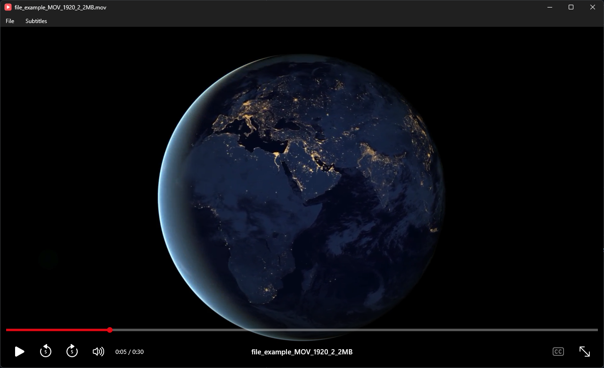

<p align="center">
  
</p>

<h1 align="center">VideoPLAYER</h1>

<p align="center">A highly optimized and minimalistic video player for Windows, built with native tools.</p>

<p align="center">
  
</p>

## Download

Get `VideoPLAYER.exe` from the [latest release](https://github.com/Mu-Ue/VideoPLAYER/releases/latest). It's a single file with no dependencies.

## Use

```
"VideoPLAYER.exe" [video.mp4] [subtitles.srt]
```

Run `VideoPLAYER.exe --register` once to add the player to Settings → Default apps. Run it again after moving the exe. `--unregister` removes it.

Plays every format Windows supports, such as MP4, MOV, MKV, AVI and WMV.

Open a video by dropping it on the window or with File → Open. Add subtitles the same way, or with Subtitles → Add subtitle file.

Subtitles built into an MKV and `.srt` files named like the video (`Movie.en.srt`) are found automatically but start hidden. Press `S` to show them, or pick an audio or subtitle track with the subtitles button.

Move the mouse to show the controls. Hover over the seek bar to preview any frame. Hover over the speed button to change the playback speed.

The player remembers the volume and where you left each video.

| Input                        | Action                  |
| ---------------------------- | ----------------------- |
| `Space` / click / media key  | Play / pause            |
| `←` / `→` / mouse side keys  | Back / forward 5 s      |
| `Ctrl+←` / `Ctrl+→`          | Back / forward 60 s     |
| `Home` / `End`               | Start / end             |
| `,` / `.`                    | Previous / next frame   |
| `Shift+,` / `Shift+.`        | Speed down / up         |
| `↑` / `↓` / scroll           | Volume up / down        |
| `M`                          | Mute                    |
| `S`                          | Subtitles on / off      |
| `F11` / double-click         | Fullscreen              |
| `Ctrl+O`                     | Open video or subtitles |
| `Alt+F`                      | File menu               |
| `Alt+S`                      | Subtitles menu          |
| `Esc`                        | Exit fullscreen / close |

## Build

Requires Visual Studio or Build Tools with the C++ workload. Run `build.bat`, or from a Developer Command Prompt:

```
cmake -S . -B build -G Ninja -DCMAKE_BUILD_TYPE=Release
cmake --build build
```

The output is `build\VideoPLAYER.exe`.
